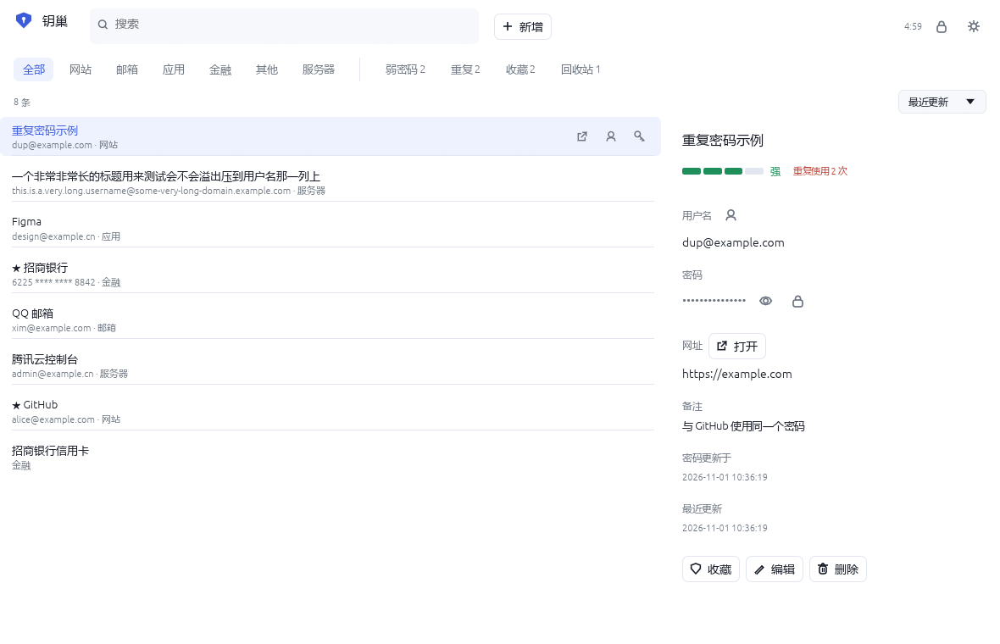
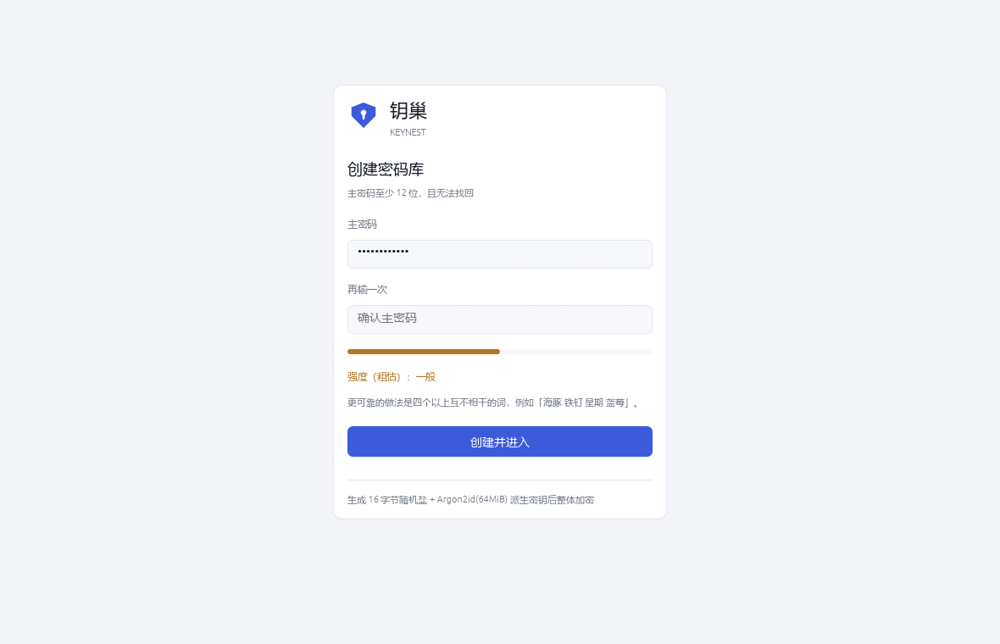
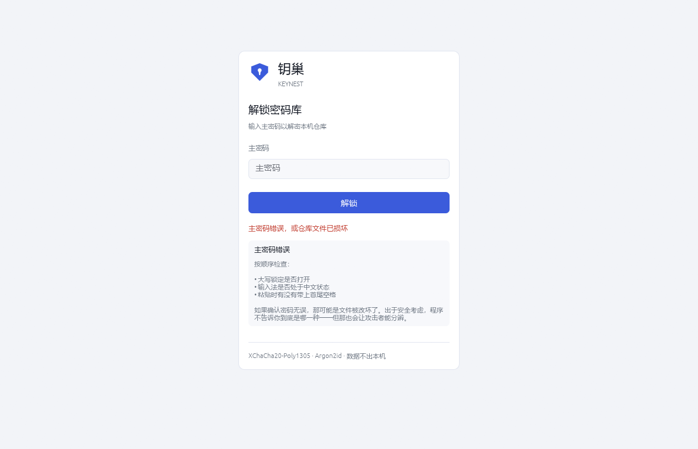
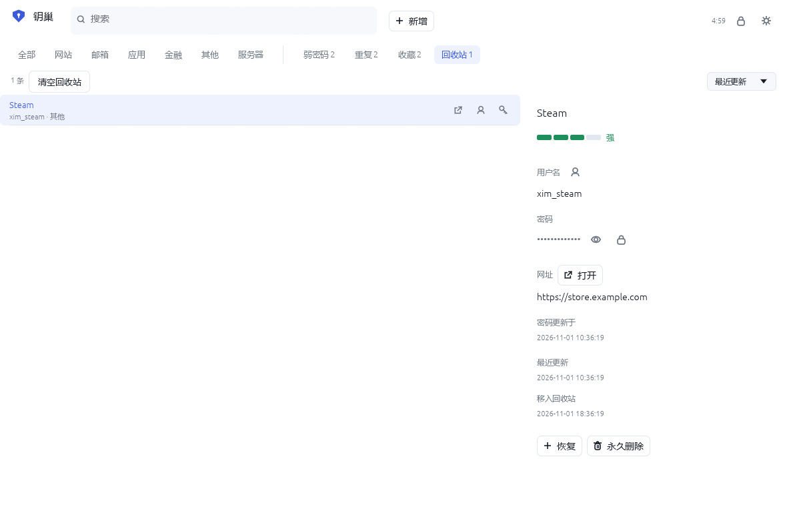
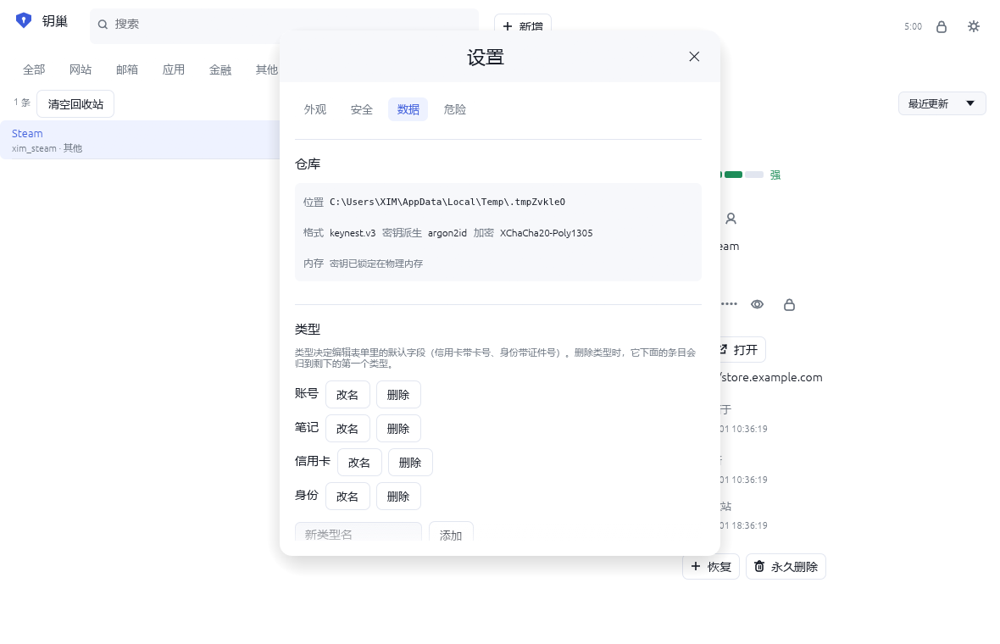

# 钥巢 KeyNest

> 每把钥匙，都有归处。

一个跑在 Windows 桌面上的**纯 Rust** 本地密码管理器。所有数据加密后只保存在本机；程序里没有一行联网代码。



**永久免费，没有广告、没有订阅、没有会员功能、没有核心功能限制。** 不注册账号、不上传云端、不收集任何数据。

---

## 目录

- [它是什么](#它是什么)
- [功能](#功能)
- [截图](#截图)
- [安装](#安装)
- [使用](#使用)
- [安全设计](#安全设计)
- [和别的密码管理器有什么不同](#和别的密码管理器有什么不同)
- [编译](#编译)
- [常见问题](#常见问题)
- [参与贡献](#参与贡献)
- [许可证](#许可证)
- [已知限制](#已知限制)

---

## 它是什么

一个把密码锁进**单个加密文件**的桌面程序。打开它需要一个主密码；主密码不落盘、不上传、无法找回。

设计上只有三条硬约束：

1. **数据是你的。** 库是本地一个文件，随时可以导出成 CSV / JSON 带走，也可以整份加密备份拷走。没有「绑定账号」这回事。
2. **不联网。** 依赖树里没有任何 HTTP 客户端。这不是「默认关闭」，是根本没有。
3. **不安全的地方要写清楚。** 见 [安全设计](#安全设计) 与 [THREAT_MODEL.md](docs/THREAT_MODEL.md)。本项目**没有**经过第三方安全审计，README 里不会出现「已通过安全审计」这种话。

---

## 功能

**密码库**

- 主密码解锁，空闲自动锁定（取「应用闲置」与「系统闲置」中较短者）
- 条目类型：账号 / 笔记 / 信用卡 / 身份，各自带默认字段模板
- 自定义字段：任意键值，可单独勾选「隐藏」（卡号、证件号在详情页打码，复制仍可用）
- 条目管理：标题、账号、密码、网址、分类、备注
- 搜索（标题 / 账号 / 网址 / 备注）、分类筛选、排序
- **收藏**：★ 标记 +「收藏」筛选
- **回收站**：删除先进回收站，可恢复或永久删除；清空需二次确认

**生成与复制**

- 密码生成器：长度、字符集可选、排除易混淆字符、熵值提示
- 点击复制；剪贴板 **20 秒自动清除**，且清除前会读回校验（不会误删你后来复制的内容）
- 复制时标记「不进剪贴板历史、不上传云剪贴板」
- 密码显示带倒计时，到点自动隐藏
- **TOTP 动态验证码**：支持 `otpauth://` 链接与 Base32 密钥，SHA-1 / SHA-256 / SHA-512，
  6–8 位、自定义周期；详情页显示当前码与剩余秒数，一键复制
  （复制时 TTL 自动截到当前时间步结束，不会把一个已过期的码留在剪贴板）

**数据进出**

- 导出 **CSV**（Bitwarden 通用列，可直接被 Bitwarden / 1Password 导入）
- 导出 **JSON**（保真：分类、备注、时间戳都在）
- 导出**加密备份**（整库副本，写完读回逐字节校验）
- 导入 **CSV / JSON**：按表头自动识别 Chrome / Edge / Firefox / Bitwarden 的导出格式
- 导入**只新增**：同名同账号跳过，绝不覆盖库里已有的密码
- 明文导出前强制二次确认，文案直说「这个文件没有任何加密」

**安全机制**

- Argon2id 密钥派生，XChaCha20-Poly1305 认证加密，DEK / KEK 分离
- 换主密码只需重新包裹 32 字节，不必重写整个库
- 密钥锁定在物理内存（`VirtualLock`），挡住换页 / 休眠文件 / 崩溃转储
- 单实例锁 + 外部改动检测：不会因为开了两个窗口而静默丢数据
- 原子写入 + 5 代备份轮转；库文件损坏时可直接从备份恢复

---

## 截图

| 创建密码库 | 解锁 |
|---|---|
|  |  |

| 回收站 | 设置 · 数据 |
|---|---|
|  |  |

截图由 `cargo run -p keynest-egui --example shots` 真实渲染生成，不是设计稿。

---

## 安装

### 直接运行

从 Releases 下载 `keynest-egui.exe`，双击即可。单文件，无需安装、无需运行库。

> 当前只提供 Windows x64 构建。核心库在 Linux / macOS 上能编译并通过全部测试，
> 但剪贴板与系统闲置检测只有 Windows 实现（见 [已知限制](#已知限制)）。

### 数据位置

| 优先 | 路径 |
|---|---|
| 1 | 环境变量 `KEYNEST_DATA_DIR` 指定的目录（便携 / 测试用） |
| 2 | 旧版遗留：`%APPDATA%\KeyNest\vault.dat` 存在时继续用这里 |
| 3 | 默认：`%LOCALAPPDATA%\KeyNest\vault.dat` |

放在 `%LOCALAPPDATA%` 而不是 `%APPDATA%` 是刻意的：后者在域环境或开启「同步设置」时
会被复制到其他机器，等于把加密库散播到用户没预期的地方。

同目录下还会有：

- `vault.dat.bak.1` … `vault.dat.bak.5` —— 最近 5 代备份
- `vault.lock` —— 单实例锁文件（内容为空，锁由操作系统持有）
- `vault.dat.corrupt-<时间戳>` —— 从备份恢复时留下的旧文件

---

## 使用

1. 首次启动 → 设置主密码（**至少 12 位**，无法找回）。
2. 点「新增」填写条目，或从「设置 → 数据 → 从文件导入」导入浏览器导出的 CSV。
3. 日常：搜索 → 点条目 → 复制密码。
4. `Ctrl+L` 锁定；离开电脑到时间会自动锁。

**换机**：设置 → 数据 → 导出加密备份；在新机器上把它放到数据目录并改名为 `vault.dat` 即可。
**迁移到别的软件**：设置 → 数据 → 导出 CSV（会二次确认，因为那是**明文**）。

---

## 安全设计

### 密钥与加密（当前格式 v3）

```text
主密码 ──Argon2id(64 MiB, t=3, p=1, 16B 随机盐)──> KEK
                                                    │
                            XChaCha20-Poly1305（AAD 绑定 KDF 参数与盐）
                                                    ↓
                                      包裹一把随机 32 字节 DEK
                                                    │
                              XChaCha20-Poly1305（每次保存换 24 字节随机 nonce）
                                                    ↓
                                                库正文
```

关键点，都可以在 `rust/keynest-core/src/vault.rs` 里逐行核对：

| 设计 | 作用 |
| --- | --- |
| 不保存密码哈希 | 用 AEAD 认证标签校验主密码，不额外泄露可离线爆破的校验值 |
| AAD 绑定格式、算法、KDF 参数、盐 | 改任何一项都会解密失败，防降级 |
| DEK / KEK 分离 | 换主密码只重新包裹 32 字节，正文密文逐字节不变 |
| 每次保存换随机 nonce | 24 字节纯随机 nonce，碰撞概率可忽略 |
| 盐、nonce、DEK 全部来自 OS CSPRNG | 直接调 `getrandom`，不经过任何用户态 PRNG |
| 密钥放进页对齐内存并 `VirtualLock` | 挡住换页 / 休眠 / 崩溃转储把密钥写到磁盘 |
| 敏感结构实现 `Drop` 清零 | 条目、密钥、明文缓冲区在离开作用域时擦除 |
| `Debug` 手写脱敏 | `{:?}` 打印条目时密码是 `<redacted>` |

**旧格式仍可读**：v1（scrypt N=2^17 + AES-256-GCM）与 v2（Argon2id + XChaCha20-Poly1305）
都能直接打开，设置页可显式升级到 v3。升级前会自动留一份可回滚的副本。

### 落盘与运行

| 设计 | 作用 |
| --- | --- |
| 临时文件 → `fsync` → `rename` | 断电不会留下「文件名对、内容是半截」的库 |
| 保存前把上一版轮转进 `.bak.1..5` | 任何一次保存都至少有一份可回退的旧版本 |
| 备份前先校验结构 | 坏文件不会顶掉好备份 |
| 保存前比对磁盘指纹 | 检测到外部改动时拒绝保存，而不是覆盖别人的改动 |
| 单实例锁（`File::try_lock`） | 两个进程各持一份明文、互相覆盖是丢数据最快的路径 |
| 解锁先做不依赖密钥的校验 | 「文件坏了」不会被伪装成「主密码错误」 |

### 能做到 / 做不到

**能防住**

- 拷走 `vault.dat`：只有密文；安全性取决于主密码强度 × Argon2id 成本
- 文件被改：认证失败，拒绝解密而不是读出脏数据
- 断电 / 崩溃：原子写入 + 备份轮转
- 多开窗口互相覆盖：单实例锁
- 剪贴板残留：定时清除 + 不进历史 + 不进云同步

**做不到（详见 [THREAT_MODEL.md](docs/THREAT_MODEL.md)）**

- 同机恶意程序读进程内存、键盘记录、截屏
- 提权后的攻击者读取已解锁进程的内存
- 弱主密码被离线爆破（Argon2id 只提高成本，不消除风险）
- **改主密码不会让旧备份失效** —— 旧备份里的包裹块仍由旧主密码保护
- 你在别的软件里生成的明文 CSV 被第三方拿走
- 屏幕被拍、人被胁迫

---

## 和别的密码管理器有什么不同

- **没有云。** 不做同步服务，也没有「可选同步」的埋点。要跨设备，自己拷加密备份。
- **没有账号。** 没有注册、没有邮箱验证、没有找回流程——也就没有「账号被盗导致库泄露」这条路。
- **没有联网代码。** 不是「默认关闭网络权限」，是依赖里根本没有 HTTP 客户端。
- **会承认自己没被审计。** 安全软件的声明必须能被独立检验，本项目只写可验证的事实。

---

## 编译

需要 Rust 1.89 以上（用到标准库的 `File::try_lock`）。

```bash
cd rust
cargo build --release -p keynest-egui
# 产物：rust/target/release/keynest-egui.exe
```

检查（与 CI 完全一致）：

```bash
cargo fmt --all --check
cargo clippy --workspace --all-targets -- -D warnings
cargo test --workspace
cargo deny check          # 需要先 cargo install cargo-deny
```

生成界面截图（跑在临时目录里，不碰真实库）：

```bash
cargo run -p keynest-egui --example shots    # 输出到 docs/shots/
```

诊断本机能力（不需要主密码）：

```bash
cargo run -p keynest-core --example security_check
```

---

## 常见问题

**忘了主密码怎么办？**
没有办法。不存哈希、不留后门、没有恢复码。这就是「没有服务端」的代价。

**库文件坏了怎么办？**
锁屏界面会检测到，并提示可用的备份（`vault.dat.bak.1` 等）。用主密码即可从备份恢复，
当前坏文件会被改名留档而不是删除。

**能不能同步到网盘？**
可以，但要想清楚：网盘会保留**历史版本**，而历史版本仍由**当时的主密码**保护。
换过密码之后，旧版本依然能被旧密码解开。

**为什么只支持 Windows？**
剪贴板安全标记（`CanIncludeInClipboardHistory` 等）和系统级闲置检测目前只有 Win32 实现。
核心加密库跨平台，GUI 可编译，但复制密码这类功能在别的平台上会明确报「不支持」而不是静默降级。

**和浏览器自带密码管理器比呢？**
浏览器密码库绑定在浏览器账号上，换浏览器就带不走。这里的数据随时可以导出成 CSV 带走。

---

## 参与贡献

见 [CONTRIBUTING.md](CONTRIBUTING.md)。安全问题的报告方式见 [SECURITY.md](SECURITY.md)。
文档索引：[ARCHITECTURE.md](docs/ARCHITECTURE.md) · [THREAT_MODEL.md](docs/THREAT_MODEL.md) · [CHANGELOG.md](CHANGELOG.md)

## 许可证

双许可，任选其一：

- [MIT](LICENSE-MIT)
- [Apache-2.0](LICENSE-APACHE)

依赖的许可证由 `cargo deny check licenses` 自动把关。其中 egui 内置字体使用
SIL OFL-1.1 / Ubuntu-font-1.0，随程序分发时需保留其许可证与署名。

## 已知限制

- 只提供 Windows x64 构建
- TOTP 暂不支持**扫二维码**识别，需要粘贴 `otpauth://` 链接或 Base32 密钥
- 没有浏览器自动填充（P2 计划中）
- 自定义字段不会写进 CSV 导出（Bitmapwarden 的 `fields` 列是自定义序列化格式），JSON 导出保真
- 界面自动化只覆盖到「渲染」一层，点击行为靠单元测试而非 UI 自动化
- 仓库里仍保留着已被取代的 Electron 实现（`src/`），1.0 前移除
