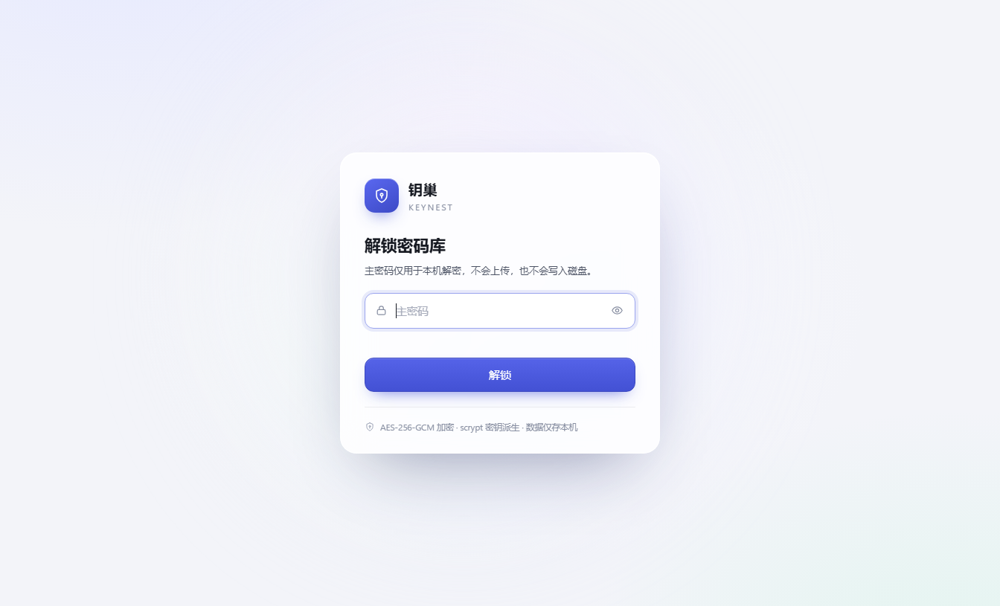
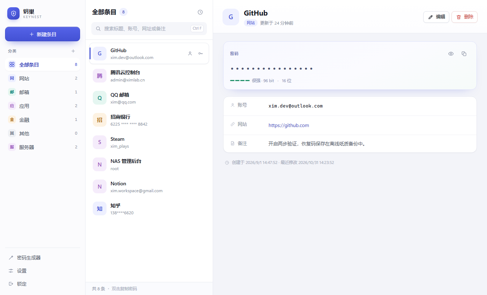
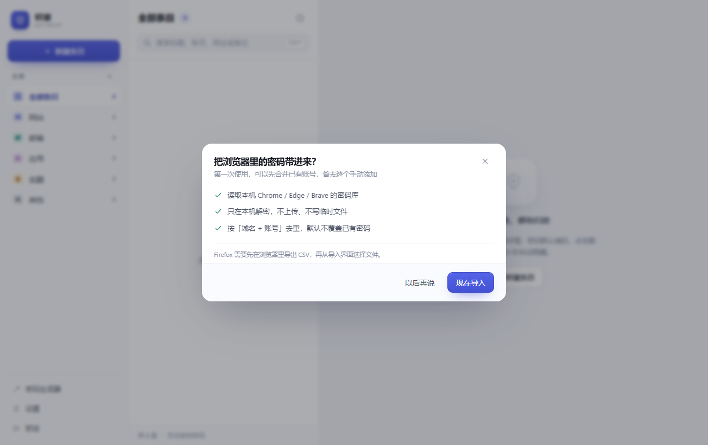
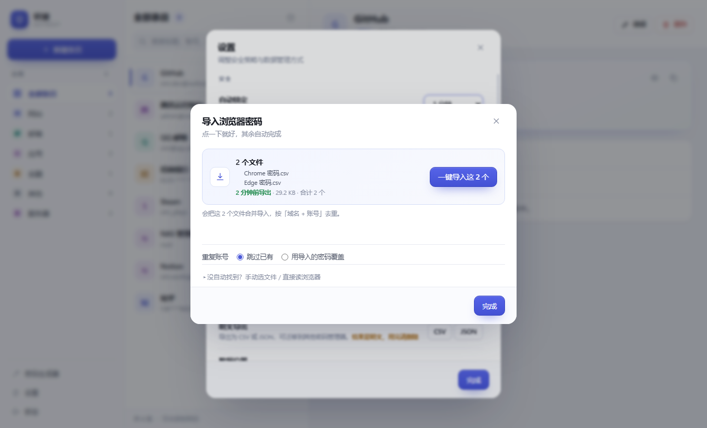

# 钥巢 KeyNest

> 每把钥匙，都有归处。

一个跑在 Windows 桌面上的本地密码管理器。所有数据加密后只保存在本机，主密码不落盘、不上传、不联网。





## 关于名字

钥巢 = 钥匙的巢。散落的钥匙需要一个归处，账号密码也是。英文 KeyNest 与中文同义，读起来也轻。

## 功能

- **主密码解锁**：首次使用设置主密码，之后每次启动输入主密码解密仓库
- **条目管理**：新增 / 查看 / 编辑 / 删除密码条目（标题、账号、密码、网址、分类、备注）
- **加密存储**：scrypt 密钥派生 + AES-256-GCM 认证加密，整库单文件
- **密码生成器**：8–48 位、大小写/数字/符号可选、排除易混淆字符，显示熵值
- **浏览器导入**：读取 Chrome / Edge / Brave 的本地密码库，或导入 Chrome / Edge / Firefox 导出的 CSV，按「域名 + 账号」去重
- **命令行导入**：`npm run import` 一条命令把导出 CSV 合并进仓库，支持自动定位最新 CSV、覆盖模式、预演、JSON 输出，可接脚本与计划任务
- **明文导出**：一键导出 CSV / JSON，可迁移到 Bitwarden、1Password 或回灌浏览器；导出前有二次确认与风险提示
- **搜索与分类**：按标题/账号/网址/备注实时搜索，分类筛选与计数，可自定义分类
- **响应式布局**：宽屏三栏 → 中等宽度图标栏 → 窄窗口抽屉 + 详情覆盖层
- **安全细节**：空闲自动锁定、剪贴板定时清除、密码显示定时隐藏、原子写入与自动备份
- **快捷键**：`Ctrl+F` 搜索、`Ctrl+N` 新建、`Ctrl+G` 生成器、`Ctrl+L` 锁定、`Esc` 关闭/返回

## 技术选型

| 层 | 选择 | 原因 |
| --- | --- | --- |
| 运行壳 | Electron 38 | Windows 下唯一能兼顾原生窗口、现代 CSS 布局与纯 JS 加密的方案，且无编译期原生依赖 |
| 界面 | 原生 HTML/CSS/JS（零构建） | 无打包步骤、改完即生效、依赖面最小 |
| 加密 | Node 内置 `crypto`：scrypt + AES-256-GCM | 不引入 argon2 等需编译的模块；scrypt 内存硬，适合抗 GPU 爆破 |
| 存储 | 单个加密文件 `vault.dat` | 结构简单、整体加密、不会出现半写坏数据 |

被否决的方案：WPF/.NET（界面开发成本高）、PySide6（打包体积与环境依赖）、浏览器 + 本地 HTTP 服务（不是真正的本地应用，还会暴露端口）。

## 目录结构

```
keynest/
├─ src/
│  ├─ main/
│  │  ├─ main.js        Electron 主进程：窗口、菜单、IPC、自动锁定、剪贴板
│  │  ├─ preload.js     白名单 IPC 桥（contextIsolation）
│  │  ├─ vault.js       加密仓库核心（纯 Node，可单测）
│  │  ├─ password.js    密码生成与强度评估
│  │  ├─ browser-import.js  浏览器密码库 / CSV 解析
│  │  ├─ csv-discovery.js   自动发现「刚导出的 CSV」（一键导入）
│  │  └─ export.js          明文导出（CSV / JSON）
│  ├─ cli/
│  │  └─ keynest-cli.js  命令行导入（scan / import / guide）
│  └─ renderer/
│     ├─ index.html     结构 + SVG 图标精灵 + CSP
│     ├─ styles.css     三栏响应式布局、浅色主题
│     └─ app.js         状态管理、渲染、事件委托、快捷键
├─ test/
│  ├─ vault.test.js     16 项加密/仓库测试（Node，无需 Electron）
│  ├─ import.test.js    15 项导入测试：CSV、AES-GCM、去重、SQLite
│  ├─ export.test.js    17 项导出测试：CSV 转义、往返一致、JSON 字段完整性
│  ├─ cli.test.js       16 项 CLI 测试：参数、CSV 定位、主密码来源、导入语义、错误路径
│  ├─ csv-discovery.test.js  13 项 CSV 自动发现测试：新鲜度、多文件合并、排序、截断
│  ├─ ui-check.js       46 项界面行为测试（mock 数据，含多文件导入与明文导出）
│  ├─ e2e-create.js     端到端：真实主进程 + UI 创建并写入
│  ├─ e2e-reopen.js     端到端：重启后用主密码解锁
│  ├─ e2e-onboard.js    端到端：首次创建后的导入引导
│  ├─ ui-shot.js        界面截图（开发用）
│  └─ ui-preload.js     截图与界面测试用的假数据层
├─ scripts/
│  └─ launch.js         启动器（清理 ELECTRON_RUN_AS_NODE 后拉起 Electron）
├─ start.cmd            双击启动
└─ package.json
```

## 安全设计

### 密钥与加密

```
主密码 ──scrypt(N=2^17, r=8, p=1, 16B 随机盐)──> 32B 主密钥（仅主进程内存）
                                                        │
                                          AES-256-GCM（每次保存新 IV）
                                                        ↓
vault.dat = { format, kdf{params,salt}, cipher{iv,tag}, payload }
```

- **不保存密码哈希**：用 GCM 的认证标签校验主密码，标签不匹配即失败，不额外泄露校验值。
- **防降级/篡改**：格式版本、KDF 参数和盐一起作为 AAD 参与认证，改动任意一项都会导致解密失败。
- **盐与 IV**：盐 16B，随机数来自 `crypto.randomBytes`；每次保存重新生成 12B IV，杜绝 IV 复用。
- **修改主密码**：验证旧密码后换新盐、重新派生并整体重加密，备份文件同步用新密钥重写。

### 落盘与运行

- **原子写入**：写 `vault.dat.tmp` → `fsync` → `rename` 覆盖；保存前把上一版复制为 `vault.dat.bak`（同样加密）。
- **进程隔离**：渲染进程 `contextIsolation: true`、`nodeIntegration: false`、`sandbox: true`；只通过 preload 暴露 18 个白名单方法。
- **禁止外联**：CSP `default-src 'none'`、`connect-src 'none'`，禁止窗口跳转与 `window.open`，拒绝所有权限请求。
- **XSS 防护**：所有用户内容经 `esc()` 转义后才进入 DOM。
- **内存与剪贴板**：锁定/退出时 `key.fill(0)` 覆盖密钥字节；复制密码后 30 秒自动清空剪贴板（且仅当内容仍是该密码）；密码默认掩码，显示 20 秒后重新隐藏。
- **自动锁定**：默认 5 分钟无操作，主进程定时检查并清空密钥，界面回到锁屏。

### 威胁模型（能做到 / 做不到）

| 场景 | 结果 |
| --- | --- |
| 直接拷走 `vault.dat` | 只能得到密文，靠主密码强度抵抗离线爆破 |
| 主密码弱（如 6 位纯数字） | scrypt 只能提高成本，仍可能被爆破，因此强制至少 8 位并提示强度 |
| 文件被改一个字节 | 认证失败，拒绝解密而非静默读出脏数据 |
| 同机恶意程序读取进程内存 / 键盘记录 | **无法防护**，这是所有本地密码管理器的共同边界 |
| 磁盘被完整镜像后做取证 | 只要主密码足够强且未在使用中，数据是密文 |
| 内存中的明文 | JS 字符串不可变，无法保证立即擦除；密钥字节已尽力清零 |

如需更强的本机保护，可后续叠加 Windows DPAPI（Electron `safeStorage`）做二次封装，或接入 Windows Hello。

## 运行

要求：Windows 10/11、Node.js 18+（本项目在 Node 22 上验证）。

```bash
cd keynest
npm install
npm start
```

或直接双击 `start.cmd`（会自动清理 `ELECTRON_RUN_AS_NODE` 并安装依赖）。

首次启动会让你设置主密码（至少 8 位）。**主密码无法找回**，忘记就只能删库重建。

### 数据位置

```
%APPDATA%\KeyNest\vault.dat      当前仓库（密文）
%APPDATA%\KeyNest\vault.dat.bak  上一版备份（密文）
```

设置里可直接打开该目录、导出加密备份。迁移到新机器时复制 `vault.dat` 即可，用同一主密码打开。

便携/测试模式：设置环境变量 `KEYNEST_DATA_DIR` 可把数据目录指到别处（本项目的 E2E 测试即用此方式）。

## 从浏览器导入密码

设置 → 数据 → 导入浏览器密码。

第一次创建密码库（或解锁一个从未提醒过的空仓库）时，钥巢会主动问一次要不要导入：



选择「以后再说」会把提醒标记写进加密仓库，之后不再打扰，仍可从设置手动进入。

### 一键导入

弹窗打开时会自动去「下载 / 桌面 / 文档」里找**最近导出的 CSV**，找到了就直接显示成一张卡片，点「一键导入」即可：

- **多个文件会合并导入**。从 Chrome 和 Edge 各导一份时，两个文件一起导入并统一按「域名 + 账号」去重，不会只导一个
- 5 分钟内修改过的文件标绿色「N 分钟前导出」；更早的标黄色提醒「可能不是刚导出的」
- 一次最多合并 10 个文件，超出时只取最近的并明确提示
- 导入完成后主按钮变成「再导入一次」，并出现「删掉这 N 个 CSV（明文文件）」，一键清除全部明文
- 某个文件读取失败不会影响其它文件，失败的文件会单独列出来
- 没找到文件时显示提示和「重新查找」按钮，不用关窗口重开

所以完整流程只有两步：**在浏览器点一次「导出密码」→ 回到钥巢点「一键导入」**。



弹窗最下面折叠着「没自动找到？手动选文件 / 直接读浏览器」，用于兜底：

- **Chrome / Edge / Brave / Chromium**：自动发现配置文件。旧版（v10/v11）可以直接导入；Chrome 127+ / Edge 127+ 默认启用应用绑定加密（v20），界面会提前标注「全部需用 CSV 导出」，不会给出必然失败的按钮。
- **CSV（新版浏览器推荐）**：Chrome / Edge / Firefox 都能导出，导入时按「域名 + 账号」去重。
- **Firefox**：密码库使用 NSS 加密，需在 `about:logins` 导出 CSV，再用「选择 CSV 文件」导入。
- **去重**：按「域名 + 账号」判断，默认跳过已有账号，也可以选择用导入的密码覆盖。
- **一次性合并**：没有后台常驻同步；想再同步一次，重复导入即可。

### 为什么新版浏览器读不出来

应用绑定加密（App-Bound Encryption）把密钥交给浏览器自己的系统服务保管，并校验调用方必须是浏览器本体。绕过它属于漏洞利用，钥巢不做这件事；浏览器自带的「导出密码」是唯一正常通道，导出时系统会要求 Windows Hello 或账户密码，这本身就是一道确认。

具体到 v20 的机制（实测 Chrome 156 / Edge 156）：

- 密钥藏在 `Local State` 的 `os_crypt.app_bound_encrypted_key`，是**双层 DPAPI**：外层由 `SYSTEM` 账户保护，内层再套当前用户。只解外层拿到的是约 132 字节的容器，里面是「浏览器安装路径 + 版本字段 + 密钥材料」，并不是可直接使用的 AES 密钥。
- 真正的解密动作必须由 `elevation_service.exe`（`GoogleChromeElevationService`，以 LocalSystem 运行）执行：COM 接口 `IElevator::DecryptData`。
- 该服务在 `caller_validation.cc` 里校验调用方：镜像路径必须位于浏览器安装目录、且通过签名/路径核对。第三方进程调用会拿到 `0x8004A004`（`DecryptData`）或 `0x8004A001`（`EncryptData`），即使把程序复制进安装目录、改名成 `chrome.exe` 也一样——因为校验还包括数字签名。

这不是「配置问题」或「参数没传对」，而是 Chrome 主动设计的边界。所以钥巢只走官方导出通道。

- Chrome / Edge / Firefox 导出的 CSV 都是**明文**，导入完成后建议删除导出文件。
- 导入过程不联网，解析在内存中完成，不会把明文写到临时文件。

## 命令行导入（自动化）

设置界面适合手动导一次；要把它放进脚本 / 批处理 / 定期任务，用 CLI。

```bash
# 1) 先看本机有哪些密码库、多少条需要走 CSV
npm run scan

# 2) 浏览器导出密码后，导入最新的那个 CSV
npm run import

# 指定文件、覆盖已有密码、只预演不落盘
node src/cli/keynest-cli.js import --csv "%USERPROFILE%\Downloads\Chrome 密码.csv"
node src/cli/keynest-cli.js import --mode overwrite
node src/cli/keynest-cli.js import --dry-run
```

不指定 `--csv` 时，会在「下载 / 桌面 / 文档 / 当前目录」里挑最近修改的 `.csv`；也可以用 `--dir` 只扫某个目录。

### 主密码怎么传

主密码**不接受命令行明文**（否则会进入 shell 历史和进程列表）。三种方式，按优先级：

```powershell
# 环境变量（适合 CI / 计划任务）
$env:KEYNEST_PASSWORD = "你的主密码"
node src/cli/keynest-cli.js import --password-env KEYNEST_PASSWORD

# 标准输入（适合管道）
"你的主密码" | node src/cli/keynest-cli.js import --password-stdin

# 都不给就交互式隐藏输入
node src/cli/keynest-cli.js import
```

### 退出码

| 码 | 含义 |
| --- | --- |
| 0 | 成功（含「没有新条目」） |
| 1 | 其他错误（CSV 不存在、仓库不存在等） |
| 2 | 命令用法错误 |
| 3 | 导入完成但一条都没写进去 |
| 4 | 主密码错误 |

### 让浏览器把密码导出自动化

浏览器本身不允许脚本直接触发「导出密码」（同样需要 Windows Hello 确认），但导出这一步可以只做一次，之后每次导入都是纯命令行：

```powershell
# 一次性：导出后放到固定位置，之后脚本只读这个文件
# Chrome: chrome://password-manager/settings → 下载文件
# Edge:   edge://settings/passwords → ... → 导出密码

# 之后每次（例如登录后自动同步）
$env:KEYNEST_PASSWORD = "..."
node src/cli/keynest-cli.js import --csv "$env:USERPROFILE\Downloads\Chrome 密码.csv" --mode overwrite
Remove-Item "$env:USERPROFILE\Downloads\Chrome 密码.csv"   # 明文文件用完就删
```

`--json` 让输出变成机器可读，方便接到你自己的流程里：

```bash
node src/cli/keynest-cli.js import --password-env KEYNEST_PASSWORD --json
```


## 测试

```bash
npm test          # 16 仓库/加密 + 15 导入 + 17 导出 + 16 CLI + 13 CSV 发现 + start.cmd 检查
npm run test:ui   # 46 项：搜索、分类、掩码、复制、排序、多文件导入、明文导出、兜底区、引导、锁定
npm run test:e2e  # 端到端：创建（含引导）→ 写入密文 → 重启解锁 → 引导跳转
```

当前状态：`npm test` 16/16 + 15/15 + 17/17 + 16/16 + 13/13、`npm run test:ui` 46/46、`npm run test:e2e` 三阶段均通过。

### 双击 start.cmd 没反应

在所在目录打开终端执行 `start.cmd`，错误会直接打印出来。

`start.cmd` 必须保持 **CRLF 行尾 + 纯 ASCII**：cmd.exe 读 LF 行尾或 UTF-8 中文注释时会解析错乱（曾出现误触发 `npm install`、`start` 那行不执行）。`npm test` 里的启动检查会拦住这种改动。

## 已知限制与可继续做的方向

- 未打包成安装包：目前通过 `npm start` / `start.cmd` 运行。需要分发时加 `electron-builder`，产出 NSIS 安装包或 portable exe。
- 无浏览器插件/自动填充、无 TOTP、无附件。
- 浏览器导入是单向、按需的合并，不是实时同步；新版 Chrome / Edge 的 v20 条目只能走浏览器的 CSV 导出（原因见上一节实测结论）。
- 浏览器的「导出密码」这一步无法脚本化：Chrome / Edge 导出前会要求 Windows Hello 或账户密码，这是浏览器自身的行为。CLI 自动化的是「导出之后」的合并环节。
- 单用户单仓库，暂不支持多库切换。
- 备份文件保留的是“上一版”，不是完整版本历史。
